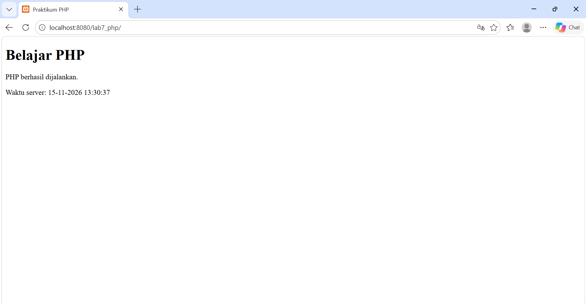
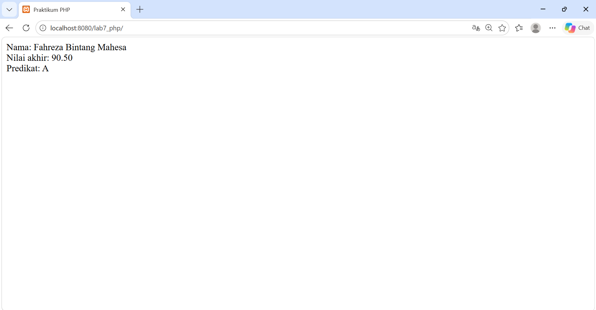
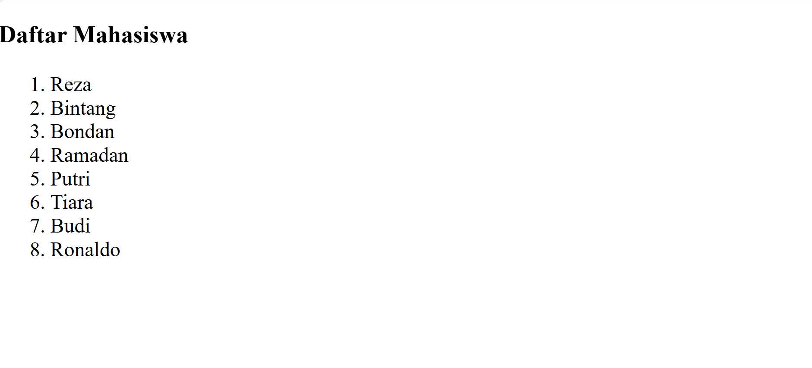
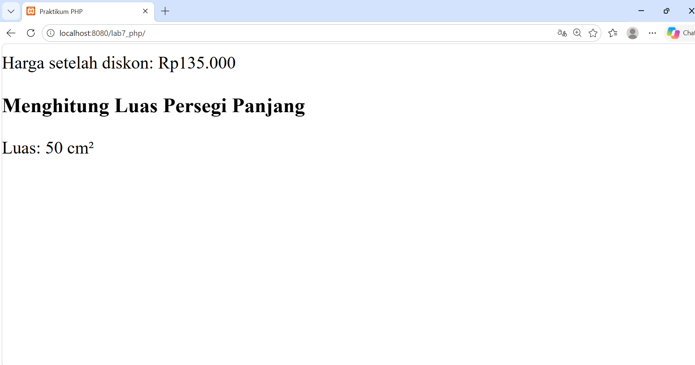
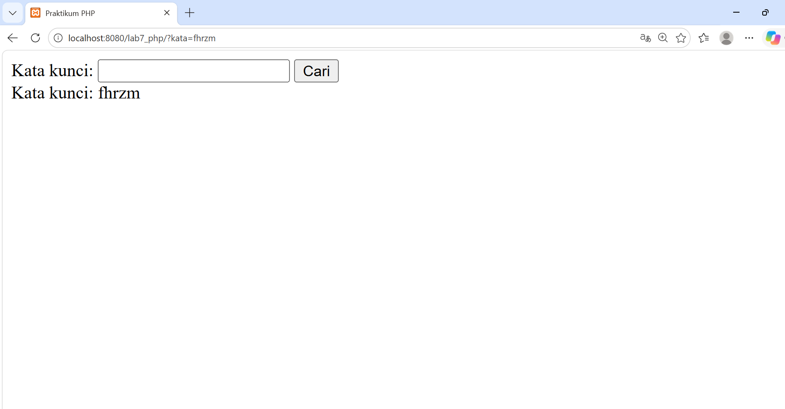
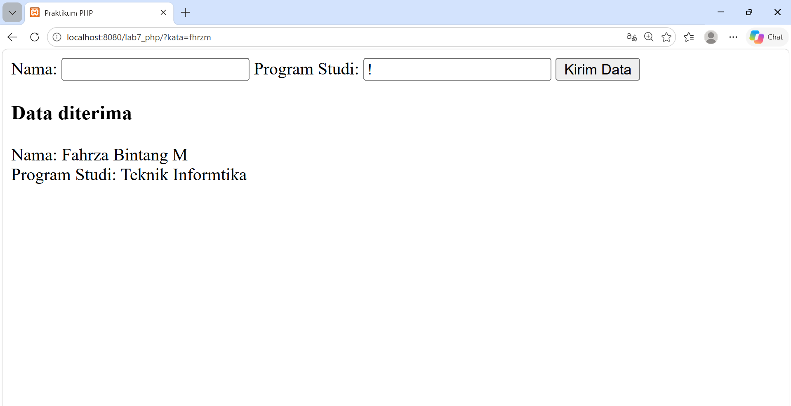
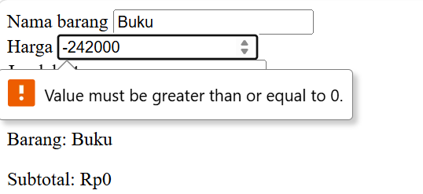
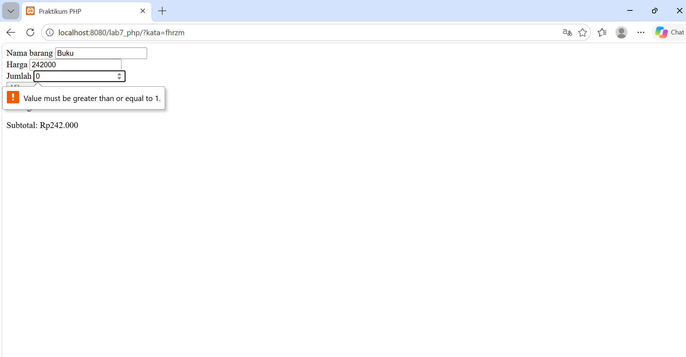
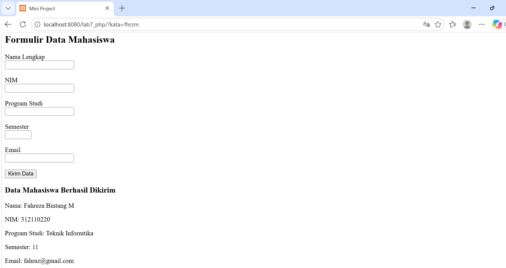

## LAPORAN PRAKTIKUM 7
Pemrograman Server-Side dengan PHP

- **NAMA**        : FAHREZA BINTANG MAHESA
- **NIM**         : 312110220
- **KELAS**       : I253A
- **MATA KULIAH** : PEMROGRAMAN WEB


## Tujuan Praktikum

Praktikum ini bertujuan untuk:

Memahami perbedaan pemrograman client-side dan server-side.

Memahami sintaks dasar PHP dan cara menjalankannya melalui web server lokal.

Menggunakan variabel, tipe data, operator, percabangan, perulangan, dan fungsi dalam PHP.

Memahami pengolahan data formulir menggunakan metode GET dan POST.

Menerapkan validasi dan sanitasi input pada PHP.

Membuat aplikasi sederhana untuk menerima, memproses, dan menampilkan data pengguna.

## 1. Struktur Folder

```
Lab7Web_PHP/
│
├── index.php
├── latihan1.php
├── latihan2.php
├── latihan3.php
├── latihan4.php
├── latihan5.php
├── latihan6.php
└── latihan7.php
```
## 2. Cara Menjalankan Program

Pastikan XAMPP sudah terpasang.

Jalankan Apache melalui XAMPP.

Simpan folder Lab7Web_PHP di dalam direktori htdocs.

Buka browser Google Chrome.

Masukkan alamat berikut:

http://localhost/Lab7Web_PHP/

Untuk menjalankan mini project, buka:

http://localhost/Lab7Web_PHP/

## 3. Hasil Praktikum

**a)** Menjalankan PHP: Memahami cara menjalankan file PHP melalui server lokal dan menampilkan output menggunakan echo.
 

**b)** Variabel, Operator, dan Percabangan: Mengolah nilai mahasiswa untuk menghitung nilai akhir dan menentukan nilai huruf.


**c)** Perulangan dan Array: Menampilkan daftar nama mahasiswa menggunakan foreach.


**d)** Function: Membuat fungsi untuk menghitung diskon dan fungsi tambahan untuk melakukan perhitungan.


**e)** Form GET: Mengambil dan menampilkan data yang dikirim melalui URL.


**f)** Form POST: Mengolah data formulir menggunakan metode POST.


**g)** Pengolahan Data Sederhana: Menghitung subtotal berdasarkan harga dan jumlah barang serta melakukan validasi input.



## 4. Mini Project: Aplikasi Formulir Data Mahasiswa

